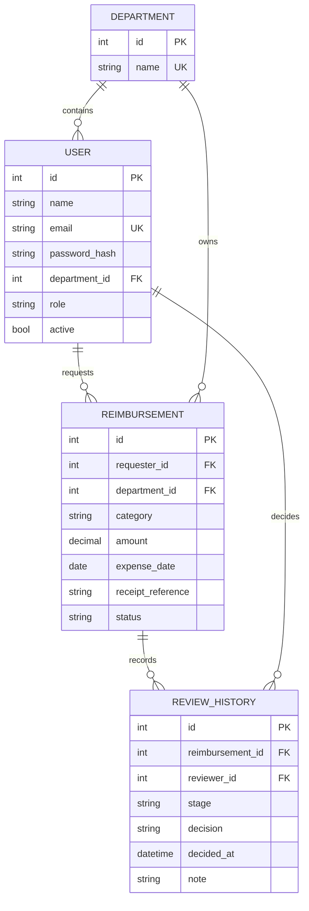

# Documentação técnica — NexusCorp Reembolsos

## 1. Descrição da solução

API REST em Python/FastAPI para registrar despesas de colaboradores e conduzi-las por análise de gestor, análise financeira e pagamento. Usa SQLite com SQLAlchemy para persistência relacional. A interface OpenAPI é gerada em `/docs`. Os dados de autenticação não são incluídos nas respostas.

## 2. Modelo de dados

Cada colaborador e cada solicitação tem vínculo com um departamento. O histórico referencia a solicitação e o usuário responsável. A referência do comprovante é única por solicitante (`requester_id + receipt_reference`). Valores usam decimal com duas casas. Senhas são armazenadas como PBKDF2-HMAC-SHA256 com salt individual.

## 3. Contrato das principais operações

Todas as operações abaixo, exceto `GET /health` e `POST /auth/token`, exigem `Authorization: Bearer <token>`. O login recebe formulário `username` e `password`.

| Método e rota | Acesso | Resultado principal |
|---|---|---|
| `POST /auth/token` | Público | Token JWT; 401 para credenciais incorretas |
| `GET /auth/me` | Autenticado | Identidade e perfil atuais, sem hash de senha |
| `POST /solicitacoes` | Autenticado | Cria rascunho; 201; 409 para comprovante duplicado |
| `GET /solicitacoes` | Autenticado | Lista visível ao perfil; financeiro vê solicitações encaminhadas à sua etapa ou que já analisou; filtros `department_id`, `situacao`, `categoria` |
| `GET /solicitacoes/{id}` | Autenticado | Detalhe e histórico; colaborador só vê os próprios; 404 oculta recursos alheios |
| `PATCH /solicitacoes/{id}` | Solicitante, rascunho | Altera categoria, valor, data, justificativa ou referência |
| `DELETE /solicitacoes/{id}` | Solicitante, rascunho | Exclui rascunho; 204 |
| `POST /solicitacoes/{id}/enviar` | Solicitante | Envia rascunho ao gestor; registra evento de submissão |
| `POST /solicitacoes/{id}/analise-gestor` | Gestor do departamento | Aprova para análise financeira ou recusa com justificativa |
| `POST /solicitacoes/{id}/analise-financeira` | Financeiro | Aprova ou recusa solicitação encaminhada pelo gestor |
| `POST /solicitacoes/{id}/pagamento` | Financeiro | Marca como paga somente após aprovação financeira |
| `GET /departamentos` | Autenticado | Lista departamentos permitidos para o perfil |

O corpo de criação usa `category` (`alimentacao`, `transporte`, `hospedagem`, `materiais`, `outros`), `amount` (> 0), `expense_date` (não futura), `justification` e `receipt_reference`. Atualizações aceitam somente esses campos; propriedades extras, como `role` e `department_id`, são rejeitadas. Para decisão, use `{"decision":"aprovar"}` ou `{"decision":"recusar","note":"motivo"}`.

Códigos usados: 401 falta/invalidade de autenticação; 403 perfil ou filtro sem permissão; 404 recurso inexistente ou oculto por confidencialidade; 409 conflito de fluxo ou duplicidade; 422 validação de entrada/regra de campo.

## 4. Matriz de permissões

| Operação | Colaborador | Gestor | Financeiro |
|---|---:|---:|---:|
| Criar solicitação própria | Sim | Sim | Sim |
| Consultar solicitação própria | Sim | Sim | Sim |
| Consultar solicitações do departamento | Próprias apenas | Sim, do próprio departamento | Sim, apenas encaminhadas à etapa financeira ou já analisadas por ela |
| Editar/excluir | Própria, somente rascunho | Não | Não |
| Enviar para análise | Própria | Própria | Própria |
| Analisar etapa do gestor | Não | Sim, somente mesmo departamento | Não |
| Analisar etapa financeira | Não | Não | Sim, somente após aprovação do gestor |
| Registrar pagamento | Não | Não | Sim, após aprovação financeira |
| Alterar perfil/departamento via API | Não | Não | Não |

A API não oferece cadastro ou alteração pública de usuários; provisionamento de contas é feito pelo script local controlado `seed_demo.py`. Aprovação/pagamento da própria solicitação é bloqueado, mesmo para quem tenha perfil gestor ou financeiro.

## 5. Regras de negócio implementadas

| Regra | Implementação |
|---|---|
| RN01 identificação | JWT obrigatório nos recursos restritos; expiração verificada |
| RN02 confidencialidade | Colaborador vê apenas próprios; acesso indevido responde 404 |
| RN03 responsabilidade departamental | Gestor limitado ao departamento em lista, filtro e decisão |
| RN04 integridade do valor | Decimal maior que zero |
| RN05 duplicidade | Restrição única no banco por solicitante e referência; erro 409 |
| RN06 data | Despesa futura rejeitada |
| RN07 alteração | Só solicitante edita/exclui quando RASCUNHO |
| RN08 sequência | Financeiro só analisa AGUARDANDO_FINANCEIRO |
| RN09 segregação | Autoria própria impede análise e pagamento |
| RN10 pagamento | Só status APROVADA pode passar a PAGA |
| RN11 recusa | Campo note obrigatório para recusar |
| RN12 rastreabilidade | Submissão, decisões e pagamento registram responsável, momento e resultado |
| RN13 credenciais | PBKDF2 com salt; hash nunca exposto; JWT assinado |
| RN14 sessão | JWT tem expiração; token expirado/inválido retorna 401; usuário inativo bloqueado |
| RN15 perfis | Sem rotas comuns para mudar perfil/vínculo; campos não permitidos são recusados |

## 6. Decisões de segurança

- OAuth2 Password Bearer com JWT assinado e validade configurável (30 minutos por padrão).
- PBKDF2-HMAC-SHA256, 310 mil iterações e salt aleatório por senha.
- Autorização verificada no servidor por usuário, perfil, departamento e situação; os campos de perfil enviados pelo cliente não determinam permissões.
- Recurso alheio a colaborador ou departamento fora do gestor retorna 404 para não confirmar sua existência.
- Decisões e pagamento são registros append-only pela API; não há rotas para editar ou apagar histórico.
- Ações inválidas não fazem commit. Constraints relacionais protegem unicidade e vínculos.
- SQLite persistente atende à execução local e demonstração da atividade; em produção, recomenda-se PostgreSQL, gestão de migrações, segredos externos, TLS, política de retenção, monitoramento e testes de carga.

## 7. Evidência e execução

`python -m pytest -v` executa os 12 testes automatizados (oito cenários de homologação e quatro verificações adicionais). Consulte a saída em `evidencias/pytest-v.txt`. A documentação interativa em `/docs` permite demonstrar login, permissões e o fluxo completo.
